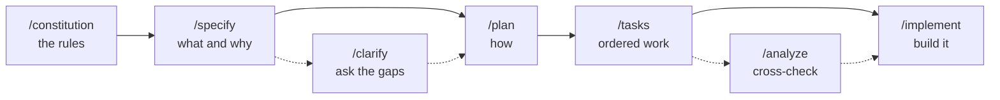
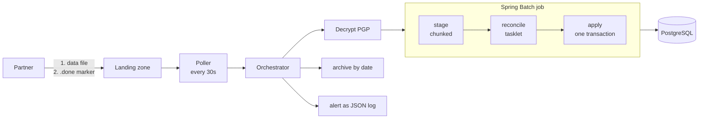

# LedgerSync-Batch — a Spec-Driven Development learning journey

A small but realistic financial batch service, built **end to end with GitHub Spec Kit and Claude
Code**, to learn how Spec-Driven Development (SDD) actually works.

The service is an **End-of-Day Transaction Settlement** job: a partner drops an encrypted CSV of
the day's transactions into a folder, and the app validates it, proves it balances against its own
header, and only then updates customer balances. Java 21, Spring Boot 3, Spring Batch 5, Liquibase,
PostgreSQL.

This repository keeps **every artifact** along the way, so you can re-read how a two-paragraph idea
became a constitution, a spec, a plan, a task list and finally running code. This README is the
notebook for that journey.

> **Just want to run or test it?** Go straight to **[docs/how-to-test.md](docs/how-to-test.md)**.
> It has a technical part and a no-code user guide with sample files.

## Contents

1. [What is Spec-Driven Development?](#1-what-is-spec-driven-development)
2. [The prompts that started it](#2-the-prompts-that-started-it)
3. [The journey, step by step](#3-the-journey-step-by-step)
4. [What got built](#4-what-got-built)
5. [Repository layout](#5-repository-layout)
6. [Quick start](#6-quick-start)
7. [How to test](#7-how-to-test)
8. [Lessons learned](#8-lessons-learned)
9. [Known issues and honest gaps](#9-known-issues-and-honest-gaps)
10. [Document index](#10-document-index)

---

## 1. What is Spec-Driven Development?

Instead of asking an AI to "build me a settlement service" and hoping, you move through a fixed
sequence of **written artifacts**, each one reviewed before the next is produced. The written spec,
not the chat, is the source of truth. Each command reads the previous artifacts and writes the next.


The same flow as a diagram, in case the image is ever lost:



| Command | Question it answers | Required? | What it produced here |
|---|---|---|---|
| `/constitution` | What rules must **every** later decision obey? | Once per project | [`constitution.md`](.specify/memory/constitution.md) v1.0.0, five principles |
| `/specify` | **What** are we building and **why**? No tech talk. | Yes | [`spec.md`](specs/001-eod-transaction-settlement/spec.md) |
| `/clarify` | What is ambiguous or contradictory in the spec? | Optional, but valuable | 5 questions answered into the spec |
| `/plan` | **How** will we build it, within the constitution? | Yes | `plan.md`, `research.md`, `data-model.md`, `contracts/`, `quickstart.md` |
| `/tasks` | What is the ordered, testable work list? | Yes | [`tasks.md`](specs/001-eod-transaction-settlement/tasks.md) |
| `/analyze` | Do spec, plan and tasks agree with each other and the constitution? | Optional, read-only | A 16-finding report |
| `/implement` | Do the tasks. | Yes | The code in `src/` |

> **Command naming.** Spec Kit's docs write `/speckit.constitution`. In this Claude Code install the
> commands are skills named with hyphens, e.g. `/speckit-constitution`. Same thing.

---

## 2. The prompts that started it

These two prompts are the only creative input the whole project was built from. They are reproduced
exactly as written.

**`/speckit.constitution`**

```text
/speckit.constitution Create the core engineering principles for our new backend service "LedgerSync-Batch". We are using Java 21, Maven, and Spring Boot 3.x. The project must strictly enforce these rules:
1. Security: Financial data compliance is absolute. All database interactions must use explicit transaction boundaries (@Transactional). Raw database keys must never be exposed.
2. Architecture: Rely on Spring Batch 5 core mechanics (Job, Step, ItemReader, ItemProcessor, ItemWriter). Maintain a strict boundary between the Ingestion Layer, Business/Reconciliation Logic, and Data Persistence.
3. Code Quality: Enforce constructor injection instead of @Autowired field injection. Use Record types for immutable DTOs.
4. Database & Performance: Use database migration via Liquibase. Implement chunk-based processing (default 1000 records) with skip/retry logic for corrupt rows rather than failing the entire batch run.
5. Observability: Enforce structured JSON logging. Every batch run must generate a unique tracking Execution ID passed through MDC.
```

**`/speckit.specify`**

```text
/speckit.specify Write a functional specification for the End-of-Day Transaction Settlement feature.
- Goal: Systematically process incoming customer transactions from external file drops to settle daily balances.
- Inflow: A batch job triggers automatically when a new encrypted transaction CSV arrives in the target landing zone.
- Validation: The system must validate each record's format (Account Number, Transaction Amount, Type, Timestamp). Invalid rows must be safely detoured into an error table with reasons logged, without crashing the batch.
- Balancing: The service must sum all transaction deltas and match them against the total header row count/amount. If the ledger doesn't reconcile (Net Total != Header Summary), the job must status as FAILED and trigger an urgent alert hook.
- Outcome: Successfully reconciled transactions update customer balances and mark the batch run as SETTLED.
```

Everything else, including the answers to five clarifying questions, the database choice and the
architecture, came out of the workflow below.

---

## 3. The journey, step by step

| # | Step | Headline result |
|---|---|---|
| 0 | Look at the empty project | A scaffold only, constitution still a template |
| 1 | `/constitution` | v1.0.0, five enforceable principles |
| 2 | `git init` + first commit | Java/Maven `.gitignore`, branch kept as `master` |
| 3 | `/specify` | 4 user stories, 31 requirements, 2 open questions |
| 4 | `/clarify` | 5 questions, one a **real contradiction** in the brief |
| 5 | `/plan` | Three-step job, 11 researched decisions, PostgreSQL chosen |
| 6 | `/tasks` | 80 tasks across 7 phases |
| 7 | `/analyze` | 16 findings, **1 critical** caught before any code existed |
| 8 | `/implement` | 58 source files, 87 tests |
| 9 | Running it for real | **6 defects** that no test had caught |
| 10 | Learning to operate it | Poller, landing zone, sentinel, archive explained |
| 11 | This documentation | Samples, helper scripts, how-to |
| 12 | Publishing to GitHub | Public repo, and CI confirming it all on a clean machine |

### Step 0 — Look at the project

The folder held only Spec Kit scaffolding: 10 skills under `.claude/skills/`, and `.specify/` with
scripts, templates and a workflow definition. No code, no `specs/`, no git repo. The constitution
was **still the unfilled template**, every value a placeholder. That matters because Spec Kit treats
the constitution as governing law during planning and implementation.

### Step 1 — `/constitution`

Your five rules became five principles, each written as testable MUST statements with a rationale:

| # | Principle | Sharpest clause |
|---|---|---|
| I | Financial Data Security & Transactional Integrity | No implicit transaction context. No raw database keys in logs, alerts or errors |
| II | Spring Batch Layered Architecture | Ingestion, reconciliation and persistence are separate, dependencies point inward only |
| III | Explicit Dependencies & Immutable Data Carriers | Constructor injection, `private final`, DTOs as records, records never entities |
| IV | Versioned Schema & Resilient Chunk Processing | Liquibase only. Chunk 1000. Skip limits bounded. **Silent skipping prohibited** |
| V | Structured Observability & Execution Traceability | JSON logs, unique execution id through MDC, cleared on completion |

Plus a Technology Stack section, a Development Workflow with merge-blocking quality gates, and
Governance (amendment procedure, semantic versioning, compliance review). Three details were added
beyond your text: departing from chunk size 1000 needs evidence, skip limits must be bounded, and
every `Job` needs an integration test for the skip path. Version **1.0.0**, ratified 2026-10-16.

### Step 2 — Git and the first commit

`git init`, a Java/Maven `.gitignore`, the review-only "Sync Impact Report" comment stripped from the
constitution, and an initial commit of the 31 scaffold files. You preferred `master` over `main`.

### Step 3 — `/specify`

The skill derived the short name `eod-transaction-settlement` and created
`specs/001-eod-transaction-settlement/`. The spec holds **4 prioritised user stories**:

| Story | Priority | In one line |
|---|---|---|
| US1 | P1 | A clean file settles with no human involved |
| US2 | P2 | A file that doesn't balance is refused and an alert names why |
| US3 | P3 | Bad rows are reported in full without stopping the run |
| US4 | P4 | A corrected file can settle after a failure |

First draft: 31 functional requirements, 9 success criteria, 13 edge cases. A quality checklist
passed 15 of 16 items. The one failure: **two requirements could not be defaulted** and were marked
`NEEDS CLARIFICATION`.

### Step 4 — `/clarify`

Five questions, one at a time, each with a recommended option. You took the recommended option on
all five: the first by letter (`A`), the other four by saying "yes".

| # | Question | Answer | Why it mattered |
|---|---|---|---|
| 1 | When rows are rejected, compare totals against the full header or the reduced one? | **Full header.** Any rejected row fails the file, but the run still reads to the end | Your brief said *detour bad rows without crashing* **and** *fail if net total differs from the header*. With a bad row those two **cannot both hold**. This was a real contradiction |
| 2 | When should reading stop early? | Above **25%** rejected, after at least **1,000** records read | Catches the wrong file landing in the zone; small files always report in full |
| 3 | How do we know a partner finished uploading? | A **sentinel** (`.done`) file written last | Without it a half-uploaded file could be read as complete |
| 4 | What makes two deliveries "the same file"? | **Fingerprint** and **business date** as two separate rules | One rule would lock out the corrected-file path |
| 5 | May runs overlap? | **No.** Strictly serial, oldest date first | Overlapping runs on shared accounts make the outcome timing-dependent |

Result: 31 to 38 requirements, 9 to 11 success criteria, 13 to 17 edge cases, checklist **16/16**.
Three requirements nobody had asked for appeared as consequences: alert on a delivery that never
arrives, say plainly when a reject list is truncated, and make outcomes independent of how work is
chunked.

### Step 5 — `/plan`

Question 1 **dictated the architecture**. If a file must be proven to balance *before* anything is
applied, a single-pass chunked job cannot work, because by the time chunk 500 reveals a mismatch,
chunks 1 to 499 are already committed. So the job became three steps:

```text
stage (chunked, 1000)  ->  reconcile (tasklet)  ->  apply (one transaction)
```

The apply step aggregates staged rows to **one net delta per account** and writes them in a single
set-based statement. That makes all-or-nothing affordable at 500,000 rows, because it writes one row
per *account*, not one per transaction.

| Artifact | Contents |
|---|---|
| `research.md` | 11 decisions with rejected alternatives: PostgreSQL 16, PGP via Bouncy Castle, a custom skip policy, SHA-256 fingerprint, serial launcher plus advisory lock, MDC listeners, archive on any outcome, alert dispatched after commit |
| `data-model.md` | 4 tables, 6 record types, state transitions |
| `contracts/` | The partner file and sentinel contract, and the outbound alert payload |
| `quickstart.md` | 7 validation scenarios |

The constitution check **passed with one recorded deviation**: the apply step is a tasklet, not a
chunk loop, justified against three rejected alternatives. The database engine was the one decision
left to you, and you chose **PostgreSQL**.

### Step 6 — `/tasks`

80 tasks over 7 phases, **with tests mandatory**, because the constitution requires unit tests that
run without a database and an integration test per `Job`. One note in the plan: US1 alone is
demonstrable but **must not run against real balances**, because until US2 lands an unbalanced file
settles silently. US1 plus US2 is the smallest safe production increment.

### Step 7 — `/analyze`

A read-only cross-check of spec, plan and tasks, run *before* any code existed. **16 findings:
1 critical, 1 high, 7 medium, 7 low.** Coverage 96%.

The critical one: the plan wrote rejected rows from a skip listener with default transaction
propagation. Spring Batch rolls the chunk back on skip, so the reject row would be **rolled back
with it**, and the run would report "7 rejected" while the reject table sat empty. It would have
looked exactly like a clean run. The fix was `REQUIRES_NEW` plus a test that proves it. You accepted
all 16 recommendations: tasks grew from 80 to 84, and a requirement was added tying the delivery
deadline to the operational cutoff.

### Step 8 — `/implement`

58 source files and 22 test files: **56 unit tests and 31 integration tests**. Along the way:

- The constitution became **mechanical**: ArchUnit tests fail the build on field `@Autowired`, a
  record used as an entity, or a layer boundary breach. They immediately caught 16 violations in
  the project's own tests, which led to a deliberate decision to scope that one rule to production
  code.
- Integration tests ran on real PostgreSQL. Testcontainers could not talk to Docker 29 (it
  negotiates API 1.32; Docker 29 demands 1.44). After six overrides failed, tests accept an external
  database via `-Dit.jdbc.url`, and WSL provided the Docker.

### Step 9 — Running it for real found six defects

Compiling and unit tests were all green. **Running it** was not:

| # | Defect | Effect |
|---|---|---|
| 1 | The balance update used `REQUIRES_NEW` | It committed independently of the step. A real partial-settlement risk |
| 2 | `markFailed` self-deadlocked | A nested transaction waited for a row lock its own suspended parent held. Every failure path hung. Proven with `pg_stat_activity` |
| 3 | The reader was declared as `ItemReader` | That hid `ItemStream`, so the reader was never opened and every row skipped |
| 4 | **`jobLauncher.run()` does not throw when a job fails** | The orchestrator never reached its handler, so a mismatch was marked `FAILED` and **no alert was sent** |
| 5 | Observed figures were written in the step transaction | They rolled back on failure, so the alert could not state them |
| 6 | Nothing ever called the orchestrator | The app started and processed nothing |

Two more were in the tests themselves: six assertions of the form `assertThatThrownBy(() -> runJob())`
**passed vacuously** because the job never throws, and the log masker was hiding `CREDIT` along with
account numbers. Finishing state: **87 of 87 passing** and a live end-to-end run settling a real
PGP-encrypted file.

### Step 10 — Learning to operate it

Questions asked along the way, and the answers:

| Question | Answer |
|---|---|
| API or cron job? | **Neither.** A 30-second fixed-delay poller. There is no HTTP surface at all |
| Where do files go? | The landing zone (`ledgersync.landing-zone`, default `./landing`) |
| What is a sentinel? | The mailbox flag: raised last, tells the postman the letters are all in |
| Will a file be consumed instantly? | No, within one poll (up to 30s), and only once its sentinel exists |
| Where do processed files go? | `archive/<business-date>/`, **success and failure alike** |
| Reaching the WSL database from Windows | `localhost:55432` |

### Step 11 — This documentation

Five sample files, a `send` command to encrypt and drop any CSV, the how-to document, and this
README. Building the samples meant running them all, which turned up the early-stop finding in
[section 9](#9-known-issues-and-honest-gaps).

### Step 12 — Publishing to GitHub, and meeting CI

| What happened | Why it matters |
|---|---|
| Scanned every file for secrets, keys and personal details before publishing | A public push is hard to undo. Nothing was found, and the throwaway test key lives in the git-ignored `target/` folder |
| Committed in groups that follow the SDD story: specs, then code, then tests, then tooling, then docs | The history reads like the journey |
| Created the public repository with the `gh` command | `andrewxyz/sdd-demo` |
| **The first push was rejected** | GitHub will not accept a file under `.github/workflows/` unless the login token has the `workflow` permission. It had not. The permission was added through a one-time code approved in the browser |
| CI started by itself and ran three checks on GitHub's own computers | All passed. See [What is CI?](#what-is-ci-and-why-does-this-project-have-it) below |
| The speed test settled 500,000 transactions in **133 seconds** | That verified a success criterion (SC-001) that had been marked "never run", so the docs were corrected |

---

## 4. What got built



| Idea | Why |
|---|---|
| **Sentinel file as the trigger** | A half-uploaded file is never read |
| **Content fingerprint plus business date** | A true redelivery is harmless, a corrected file still gets through |
| **Stage, reconcile, apply** | Nothing touches a balance until the file is proven to balance |
| **One aggregated update per account** | All-or-nothing without a 500,000-row transaction |
| **Reject rows written in their own transaction** | They survive the chunk rollback that skipping causes |
| **`FAILED` written after the job ends** | Writing it inside the step deadlocks on its own row lock |
| **Alerts sent after the outcome is committed** | An alert sent inside a rolled-back transaction is lost with it |
| **Reconciliation core depends on nothing** | Testable with no database and no Spring |
| **Serial runs plus a database advisory lock** | No overlap, even across two app instances |

Four tables: `settlement_run` (the audit unit, with a unique fingerprint), `settlement_staged_transaction`,
`settlement_rejected_record`, `customer_balance` (owned by an existing system, this feature only updates it).

---

## 5. Repository layout

```text
.
├── README.md                     <- you are here
├── docs/
│   ├── how-to-test.md            <- run and test it: technical + no-code user guide
│   ├── runbook.md                <- operations: alerts, queries, reprocessing
│   └── images/spec-kit-workflow.png
├── samples/                      <- five ready-to-send CSV files
├── scripts/
│   ├── it-db.sh                  <- start/stop the test PostgreSQL
│   └── e2e-setup.sh              <- keys, seed, send, check, reset
├── specs/001-eod-transaction-settlement/
│   ├── spec.md  plan.md  tasks.md  research.md  data-model.md  quickstart.md
│   ├── contracts/                <- partner file contract, alert payload
│   └── checklists/requirements.md
├── .specify/                     <- Spec Kit: constitution, templates, scripts, workflow
├── .claude/skills/               <- the /speckit-* commands
├── .github/                      <- CI workflow, pull request template
├── pom.xml  docker-compose.yml
├── landing/                      <- where files are dropped. NOT in a clone: you create it
├── archive/                      <- where processed files move. Created by the app
└── src/
    ├── main/java/com/ledgersync/batch/
    │   ├── domain/               <- records shared by the layers
    │   ├── ingestion/            <- poller, scanner, decrypt, fingerprint, parsers, archiver
    │   ├── reconciliation/       <- validator, reconciliation, skip policy (no I/O)
    │   ├── persistence/          <- entities, repositories, writers, balance applier
    │   ├── alerting/             <- alert payload, dispatcher, default log adapter
    │   ├── observability/        <- execution id and MDC listeners
    │   └── config/               <- job definition, properties, serial launcher, locks
    ├── main/resources/           <- application.yml, logback, Liquibase changelogs
    └── test/java/                <- unit/, integration/, arch/, fixtures/
```

---

## 6. Quick start

```bash
scripts/it-db.sh start                                     # PostgreSQL on port 55432
mvn test                                                   # 56 unit tests, no Docker needed
mvn verify -DexcludedGroups=slow -Dit.jdbc.url=$(scripts/it-db.sh url)   # + 31 integration tests
```

To run the live app and send a sample file, follow
**[Part A4 of the how-to](docs/how-to-test.md#a4-tier-3--run-the-live-app-end-to-end)**.

> **Where are the `landing/` and `archive/` folders?** In the project root, **but not in a fresh
> clone**. Both are git-ignored and appear only once you run things. Create them first with
> `mkdir -p landing archive`: the app never creates `landing`, and if it is missing it logs a
> warning and silently does nothing. Defaults, how to change them, and a gotcha about starting the
> app from a different folder are in
> **[how-to B4](docs/how-to-test.md#b4-where-to-put-the-files)**.

## 7. How to test

Everything lives in **[docs/how-to-test.md](docs/how-to-test.md)**:

| You are... | Section |
|---|---|
| A developer who wants the test suites and the live app | [Part A — Technical](docs/how-to-test.md#part-a--technical) |
| Someone who wants to drop a file and see what happens | [Part B — User guide](docs/how-to-test.md#part-b--user-guide-no-code-needed) |
| Looking for the file format, folder, and where files end up | [B3](docs/how-to-test.md#b3-what-goes-inside-the-file), [B4](docs/how-to-test.md#b4-where-to-put-the-files), [B5](docs/how-to-test.md#b5-what-happens-to-the-file-its-life-cycle) |
| Looking for sample files and expected results | [B6](docs/how-to-test.md#b6-sample-files) |
| Looking for the SQL to check results | [B7](docs/how-to-test.md#b7-checking-the-result-in-the-database) |
| Looking to watch or re-run CI | [A6](docs/how-to-test.md#a6-ci--see-it-re-run-it) |

### What is CI, and why does this project have it?

**CI** stands for **Continuous Integration**. In plain words:

> **A robot that automatically checks the project every time a change is uploaded to GitHub.**

**An analogy.** Think of a restaurant kitchen. You are the chef and each change is a dish. Before a
dish reaches a customer, a **taste-tester** tries it, and bad dishes go back. That taste-tester is
CI. It never gets tired, never forgets, and tests every dish the same way every time.

**Why have it**

| Without CI | With CI |
|---|---|
| "It works on my computer" but fails on someone else's | It tests on a **brand-new, clean machine** every time |
| You forget to run the tests before uploading | It runs **automatically**, so you can't forget |
| A broken change slips in unnoticed | A **red ✗** appears straight away |
| Two people's changes break each other | It checks the **combined result** |

The first row matters most here. On the developer's laptop, Docker 29 broke the test tooling and
workarounds were needed. A clean machine has none of that setup and none of those tricks, so a pass
there means the code works on its own.

**What it does in this repository.** The recipe is
[`.github/workflows/ci.yml`](.github/workflows/ci.yml). On every push to `master`, on every pull
request, and whenever you start it by hand, GitHub runs three jobs on its own computers:

| Job | What it checks | First run |
|---|---|---|
| Unit tests and constitution gates | 56 tests, including the ArchUnit rules, with **no Docker** | ✅ passed |
| Integration tests | 31 tests against a real PostgreSQL database | ✅ passed |
| Throughput | 500,000 transactions settled within 30 minutes | ✅ passed in 133 seconds |

**Where to look.** Open the repository on GitHub and click the **Actions** tab. A green tick means
everything passed. A red cross means something broke, and clicking it shows what.

**Starting it by hand** (needs the GitHub CLI, `gh`). Run these inside the repository folder:

```bash
gh workflow run ci.yml        # start a brand-new run now, on the latest code
gh run list                   # the new run appears with the event "workflow_dispatch"
gh run watch                  # pick it from the list and follow it live
```

On GitHub you can do the same without the terminal: **Actions** tab, choose **CI** on the left,
then the **Run workflow** button.

**Re-running an existing run:**

```bash
gh run list                                     # find a run ID: the long number in each row
gh run rerun <run-id>                           # run all the jobs of that run again
gh run rerun $(gh run list --limit 1 --json databaseId --jq '.[0].databaseId')   # re-run the newest run
```

The run ID is the long number such as `38900788822` in the `gh run list` output, and also the end of
a run's web address. Where it comes from, the difference between starting and re-running, and how to
run the same checks locally are explained in **[how-to A6](docs/how-to-test.md#a6-ci--see-it-re-run-it)**.

**How it ties back to this journey.** The constitution said rules such as "no field `@Autowired`"
are non-negotiable. CI is what **enforces** them: if someone later breaks a rule, the build turns red
and the change should not be merged. Without CI, those rules are only a wish.

> **Small thing to know:** the Throughput job is labelled "nightly" in the workflow file, but it
> actually runs on every push to `master` and on every manual run. It takes about 2.5 minutes, so it
> is cheap, but the label is misleading.

---

## 8. Lessons learned

1. **A spec is the cheapest place to find a contradiction.** "Detour bad rows without crashing"
   and "fail if totals differ" cannot both be true. Finding it in `/clarify` cost one question;
   finding it in production would have cost a night's settlement.
2. **A single answer can reshape the whole design.** Question 1 forced staging, which forced the
   three-step job, which forced the aggregated apply. Requirements drive architecture, not the reverse.
3. **`/analyze` before `/implement` is worth the pause.** It caught a bug that would have lost data
   *silently* and looked identical to success.
4. **Rules you cannot enforce are suggestions.** Turning the constitution into ArchUnit tests meant
   it caught violations immediately, including in the tests themselves.
5. **Running the code finds what review cannot.** Six defects survived a spec, a plan, a task list,
   an analysis and a green unit suite. The worst, `jobLauncher.run()` not throwing on failure, made
   the system fail silently, which is exactly what the spec was written to prevent.
6. **A passing test can be vacuous.** Six `assertThatThrownBy` assertions passed because the thing
   they expected to throw never throws. Always ask what would make a test fail.
7. **Tests that run a different configuration than production prove less than they appear to.**
   Integration tests use chunk size 100 for speed. At the production size of 1,000 the early-stop
   behaviour is different (section 9). The tests were green; production behaviour was not what the
   tests implied.
8. **Run what you document.** Building the samples meant running every one, and that is what
   exposed the early-stop gap. Documentation written from memory would have claimed it worked.
9. **The environment is part of the story.** Docker 29 broke Testcontainers. Recording the
   workaround, rather than hiding it, makes the project reproducible.
10. **A clean machine is an independent witness.** Everything passed locally, but only CI could say
    it works without any of the local workarounds. It also settled the one claim nobody had been
    able to check: 500,000 transactions in 133 seconds. Publishing is part of testing.

---

## 9. Known issues and honest gaps

Found by running the system. None are hidden, and none are fixed yet.

| # | Issue | Detail |
|---|---|---|
| 1 | **Early-stop is degraded** | A file over 25% bad *is* abandoned and the run `FAILED`. But `early_stopped` is **never set**, the alert is the generic `RECONCILIATION_MISMATCH` with the message `Skip limit of '0' exceeded` instead of `EARLY_STOP_THRESHOLD`, and at the production chunk size of 1,000 **no rejected rows are recorded** (skip callbacks fire at chunk commit, and the abandoned chunk never commits). Root cause: Spring Batch combines the custom skip policy with its own default limit of 0. Integration tests miss it because they use chunk size 100 |
| 2 | `records_applied` counts **accounts**, not transactions | A 3-row file touching 2 accounts shows `2`. FR-026 says records applied |
| 3 | The header's business date is **ignored** | Only the filename date counts |
| 4 | Row timestamps are judged in **UTC** | The spec says "within the business date" and never says whose timezone |
| 5 | A held (`SETTLED_DATE_CONFLICT`) file **re-alerts on every poll** | Until someone removes it |
| 6 | One orphan sentinel **blocks the whole scan** | And re-alerts each poll |
| 7 | `DELIVERY_OVERDUE` is **noisy** | Fires every 15 minutes for any day with no settled file, including weekends |
| 8 | Archiving **overwrites** a same-named file | Earlier evidence for a reused filename is lost |
| 9 | PGP **signature verification** is not implemented | The file contract says to verify if signed |
| 10 | No manual trigger | No endpoint or command to force a scan |
| 11 | Some paths have **no automated test** | The missed-delivery deadline monitor and the retention purge. (The throughput target SC-001 *is* covered: CI settled 500,000 transactions in 133 seconds against a 30-minute budget) |
| 12 | `tasks.md` checkboxes were **never ticked** | Implementation tracked in conversation, not in the file. `/speckit-converge` would reconcile it |
| 13 | Testcontainers fails on **Docker 29+** | Worked around with `-Dit.jdbc.url`. Fine on older Docker, and fine on GitHub's CI runners |
| 14 | A badly encrypted file gives **raw Java errors and the wrong alert** | `FileDecryptor` only converts `IOException` and `PGPException` into the proper decryption error. A plain CSV or password-only encryption instead surfaces a `NullPointerException` or `ClassCastException` message under a generic `RECONCILIATION_MISMATCH` alert, not `DECRYPTION_FAILED`. Only the wrong-key case behaves as designed. Found by trying all four bad-encryption cases against the live app after the docs had wrongly claimed otherwise |
| 15 | A **flaky integration test** | `AlertDisclosureIT.alerts_are_published_promptly` asserts that exactly one alert was captured. But the scheduled missed-delivery monitor also fires an alert as soon as the test application starts, through the same capturing publisher. When the two overlap the count is 2 and the test fails. Observed once in CI (two captured alerts 50 microseconds apart, on the fourth attempt of a run that had passed three times); it passes locally. A test-only fix is to assert on the alert for the test's own execution id instead of on the total count |

Item 1 is the one to fix first: it is a stated requirement (FR-015a) that behaves differently from
what the spec, the tests and the how-to's own test table suggest.

---

## 10. Document index

| Document | Purpose |
|---|---|
| [docs/how-to-test.md](docs/how-to-test.md) | Run and test it, technical and no-code |
| [docs/runbook.md](docs/runbook.md) | Operations: alerts, queries, reprocessing a date |
| [.specify/memory/constitution.md](.specify/memory/constitution.md) | The five principles and governance |
| [specs/001-eod-transaction-settlement/spec.md](specs/001-eod-transaction-settlement/spec.md) | What and why: stories, requirements, clarifications |
| [specs/001-eod-transaction-settlement/plan.md](specs/001-eod-transaction-settlement/plan.md) | Technical context, constitution check, structure |
| [specs/001-eod-transaction-settlement/research.md](specs/001-eod-transaction-settlement/research.md) | The 11 decisions and rejected alternatives |
| [specs/001-eod-transaction-settlement/data-model.md](specs/001-eod-transaction-settlement/data-model.md) | Tables, records, state transitions |
| [specs/001-eod-transaction-settlement/contracts/](specs/001-eod-transaction-settlement/contracts/) | Partner file contract, alert payload contract |
| [specs/001-eod-transaction-settlement/quickstart.md](specs/001-eod-transaction-settlement/quickstart.md) | The seven validation scenarios |
| [specs/001-eod-transaction-settlement/tasks.md](specs/001-eod-transaction-settlement/tasks.md) | The 84-task backlog and the analysis remediation table |
| [samples/](samples/) | Five CSV files to send |
