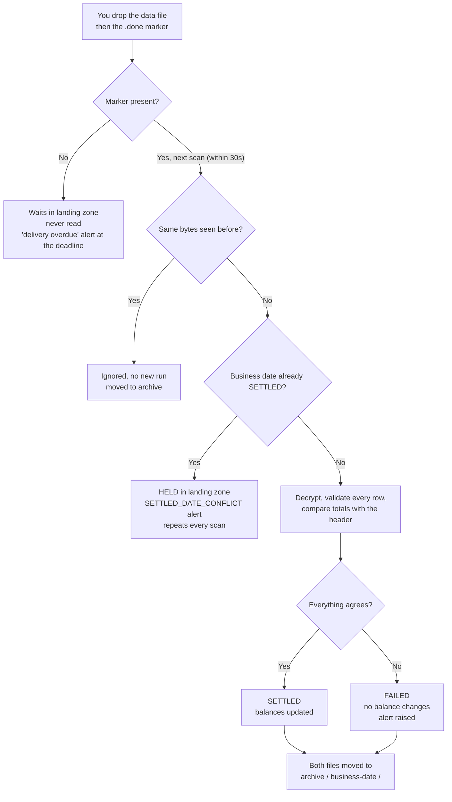

# How to test LedgerSync-Batch

Two audiences, two parts. Everything here was run for real against PostgreSQL 16 with real PGP
encryption, and the "expected results" are what was **observed**, not what was hoped for.

| If you are... | Read |
|---|---|
| A developer or tester who wants to run the test suites and the live app | [Part A — Technical](#part-a--technical) |
| Someone who just wants to drop a file and see what happens | [Part B — User guide](#part-b--user-guide-no-code-needed) |

**Back to the [README](../README.md).**

---

## The 30-second picture

A partner institution drops an **encrypted CSV of the day's transactions** into a folder, followed
by a tiny **`.done` marker file**. The app notices the marker, decrypts the file, checks every row,
proves the file adds up against its own header, and only then updates customer balances.

```text
partner drops:   txn-20261016-01.csv.pgp         <- the data (encrypted)
                 txn-20261016-01.csv.pgp.done    <- "I've finished uploading"

app (every 30s): sees the .done  ->  decrypt  ->  validate rows  ->  reconcile  ->  update balances
                                                                         |
                                           doesn't add up?  ->  FAILED, nothing changes, alert raised
```

There is **no API and no web page**. The only input is a file in a folder; the only outputs are
database rows, a moved file, and (on failure) a JSON alert line in the app log.

---

# Part A — Technical

## A1. Prerequisites

| Need | Why |
|---|---|
| JDK 21 and Maven 3.9+ | build and unit tests |
| WSL (Ubuntu) with Docker, `gpg` and a JDK | integration tests, and the live end-to-end run |
| `bash` | the helper scripts in `scripts/` are bash |

The scripts and the live run are designed for **WSL** (or any Linux/macOS shell). Unit tests also
run on plain Windows.

> **Docker Engine 29 or newer:** Testcontainers cannot start a container, because its bundled
> docker-java negotiates Docker API 1.32 and Docker 29 refuses anything below 1.44. Six documented
> overrides were tried and none worked. Use the external-database route in A3 instead. On older
> Docker, plain `mvn verify` works untouched and none of this applies.

## A2. Tier 1 — unit tests (no Docker, no database)

```bash
mvn test
```

Expect **56 tests, 0 failures**. This needs no database and no Spring context, which is a
constitutional requirement rather than a convenience.

| Test class | Covers |
|---|---|
| `ReconciliationServiceTest` (8) | declared vs observed arithmetic, and the rule that **any** rejected row makes a file unreconcilable |
| `RecordValidatorTest` (10) | every validation rule: account, amount precision, type, timestamp |
| `FileHeaderParserTest` (11) | header parsing and rejection of malformed headers |
| `ThresholdSkipPolicyTest` (5) | the 25%-after-1,000-records early-stop rule and its floor |
| `MaskingTest` (6) | account numbers masked before storage |
| `MdcLifecycleTest` (5) | execution id bound to the logging context and cleared afterwards |
| `SettlementPropertiesTest` (5) | config validation, including the delivery-deadline-vs-cutoff rule |
| `ConstitutionRulesTest` (6) | **ArchUnit gates** that fail the build on field `@Autowired`, a record used as an entity, or a layer boundary breach |

## A3. Tier 2 — integration tests (real PostgreSQL)

```bash
# Docker 29+ : start the database yourself, then point the tests at it
scripts/it-db.sh start
mvn verify -DexcludedGroups=slow -Dit.jdbc.url=$(scripts/it-db.sh url)

# Older Docker : Testcontainers starts its own database
mvn verify -DexcludedGroups=slow
```

Expect **87 tests in total (56 unit + 31 integration), BUILD SUCCESS**.

`scripts/it-db.sh` takes `start`, `stop`, `restart` (wipes data), `status`, `psql` and `url`.

| Integration test | Proves |
|---|---|
| `CleanFileSettlementIT` (3) | A valid file settles and balances move correctly |
| `ReconciliationFailureIT` (3) | An unbalanced file moves **no** balance, including accounts it never mentioned |
| `RejectedRecordIT` (4) | Every defect is reported, including one on the very last row |
| `RejectSurvivesRollbackIT` (2) | A reject row survives the chunk rollback Spring Batch performs on skip |
| `EarlyStopIT` (2) | A hopeless file is abandoned early; a small file with many rejects is not |
| `RedeliveryIT` (2) | Fail, then identical redelivery ignored, then correction settles |
| `AtomicityIT` (2) | Balance updates are all-or-nothing under an injected failure |
| `ReproducibilityIT` (2) | Same file gives the same balances regardless of chunk boundaries |
| `AlertDisclosureIT` (5) | Alerts carry the needed figures and no account numbers or surrogate ids |
| `FingerprintConcurrencyIT` (3) | The unique index, not application code, guarantees idempotency |
| `LoggingComplianceIT` (3) | One execution id per run, and no account numbers in logs |

Notes:
- Integration tests use a chunk size of **100**, not the production default of 1,000. A skipped item
  makes Spring Batch replay its chunk item by item, so 1,000 made the reject-heavy tests take
  minutes. The logic under test is identical.
- `mvn clean` can fail from WSL on `target/failsafe-reports` when Windows holds a file handle. Run
  `mvn verify` without `clean`, or clean from Windows.
- `ThroughputIT` (500,000 rows within 30 minutes, SC-001) is tagged `slow` and excluded above. Run
  it with `mvn verify -Dgroups=slow`. The CI workflow runs it on every push to `master`, and it
  settled 500,000 transactions in **133 seconds** on a standard GitHub runner.

## A4. Tier 3 — run the live app end to end

This is the only tier that exercises **PGP decryption** and the folder-polling trigger.

```bash
# 1. database + build
scripts/it-db.sh start
mvn -DskipTests package                 # builds target/ledgersync-batch-1.0.0-SNAPSHOT.jar

# 2. a throwaway PGP keypair (test material only, no passphrase)
scripts/e2e-setup.sh keys

# 3. start the app (leave this terminal open). Poll every 5s instead of 30s so you don't wait.
mkdir -p landing archive
java -jar target/ledgersync-batch-1.0.0-SNAPSHOT.jar \
  --ledgersync.landing-zone=./landing \
  --ledgersync.archive=./archive \
  --ledgersync.private-key-path=./target/e2e-keys/private.asc \
  --ledgersync.poll.interval=PT5S \
  --spring.datasource.url=jdbc:postgresql://localhost:55432/ledgersync \
  --spring.datasource.username=ledgersync \
  --spring.datasource.password=ledgersync

# 4. in a SECOND terminal: create two customer accounts, then send a sample
scripts/e2e-setup.sh seed
scripts/e2e-setup.sh send samples/01-clean-settles.csv
scripts/e2e-setup.sh check
```

Run `seed` **after** the app has started, because the app creates the tables on first start.
Part B walks through all five sample files and what each should produce.

`scripts/e2e-setup.sh` commands:

| Command | Does |
|---|---|
| `keys` | generate the test keypair in `target/e2e-keys/` |
| `seed` | insert `GB29NWBK60161331926819` = 1000.00 and `GB94BARC10201530093459` = 500.00 |
| `send FILE.csv [seq]` | encrypt **your own CSV** and drop it, data file first, `.done` second. The filename date comes from the CSV's header row; the sequence number is picked automatically. |
| `drop <fixture>` | build and drop a built-in fixture: `clean`, `unbalanced`, `defects`, `hopeless`, `redeliver`, `no-sentinel` |
| `check` | print runs, balances and the first rejected rows |
| `reset` | clear landing zone, archive and every database row (keeps the keys) |

## A5. Troubleshooting

| Symptom | Cause and fix |
|---|---|
| Nothing happens after dropping a file | The landing folder doesn't exist (the app only logs a warning), or the file is in a subfolder (the scan is not recursive), or there is no `.done` marker |
| `relation "customer_balance" does not exist` on `seed` | The app hasn't started yet, so Liquibase hasn't created the tables |
| `Connection refused` on 55432 | The database container is down. `scripts/it-db.sh start` |
| Every row rejected, `Account is not recognised` | The accounts were never seeded |
| `DECRYPTION_FAILED` | The file was encrypted to a different key than the app holds |
| `RECONCILIATION_MISMATCH` mentioning `null` or `cast` | The file was plain CSV or password-encrypted. Re-encrypt it to the app's public key |
| Second file for a date is ignored or held | That business date is already `SETTLED`. Use a new date, or `scripts/e2e-setup.sh reset` |
| `Could not find a valid Docker environment` | Docker 29+ with Testcontainers. Use `-Dit.jdbc.url` (A3) |
| `repackage` error during `mvn verify` | The jar is still held by a running app. Stop it first |
| gpg: `unsafe permissions on homedir` | Harmless on a Windows-mounted drive; the script suppresses it |

## A6. CI — see it, re-run it

CI is the robot that runs the tests on GitHub's own computers every time you push. If the idea is
new to you, start with [What is CI?](../README.md#what-is-ci-and-why-does-this-project-have-it).
You can watch it and re-run it from your terminal with the GitHub CLI.

**Prerequisite:** `gh` installed and signed in. Check with `gh auth status`.

| Command | What it does |
|---|---|
| `gh run list` | List recent runs, newest first |
| `gh run view <run-id>` | Show one run and its jobs |
| `gh run watch <run-id>` | Follow a run live until it finishes |
| `gh run rerun <run-id>` | Run all of its jobs again |
| `gh run rerun <run-id> --failed` | Run again only the jobs that failed |

Inside the cloned repository folder, `gh` finds the repository by itself. From anywhere else, add
`-R <owner>/<repo>`, for example `-R andrewxyz/sdd-demo`.

### Where the run ID comes from

Every CI run gets its own unique number from GitHub. It is the long number in the `gh run list`
output:

```text
completed  success  docs: say where the landing...  CI    master  push   38900788822  2m43s     2026-10-16T12:39:11Z
status     result   commit message                  flow  branch  event  RUN ID       duration  started
```

It is also the last part of the run's web address, so you can click a run in the repository's
**Actions** tab and copy it from the URL:

```text
https://github.com/andrewxyz/sdd-demo/actions/runs/38900788822
                                                   └── the run ID
```

### The commands

```bash
# 1. Look at the recent runs and pick an ID
gh run list

# 2. Re-run one of them. The number is only an example: use an ID from your own list
gh run rerun 38900788822 -R andrewxyz/sdd-demo

# 3. Re-run whichever run is the newest, without copying the ID yourself
gh run rerun $(gh run list -R andrewxyz/sdd-demo --limit 1 --json databaseId --jq '.[0].databaseId') -R andrewxyz/sdd-demo
```

**How command 3 works.** The part inside `$( ... )` runs first:

| Piece | Meaning |
|---|---|
| `gh run list --limit 1` | fetch only the newest run |
| `--json databaseId` | ask for just its ID field |
| `--jq '.[0].databaseId'` | pull the number out of the result |
| the outer `gh run rerun <that number>` | re-run it |

This was tested: the run's attempt count went from 3 to 4.

### Good to know

- **IDs go stale.** Every push creates a new run with a new ID, so run `gh run list` and use the
  number you see now.
- **Only a finished run can be re-run.** Trying one that is still `in_progress` is refused with
  `run <id> cannot be rerun; This workflow is already running`. Wait for it to finish.
- **A re-run uses the same commit.** It re-checks the same code, and the run's ID stays the same
  while its *attempt* number goes up. To check new code, push it.
- **There is no "run from scratch" command yet.** The workflow only starts on a push to `master` or
  a pull request, so `gh workflow run ci.yml` fails with *does not have a workflow_dispatch
  trigger*. To start a run without changing any code, push an empty commit:
  `git commit --allow-empty -m "ci: trigger a run" && git push`.
  Adding a manual trigger would be a small change to `ci.yml`, but the throughput job is limited to
  `push` events, so it would also need adjusting or it would be skipped on a manual run.

### The same checks on your own machine

Each CI job is just commands you can run yourself:

| CI job | Run it locally |
|---|---|
| Unit tests and constitution gates | `mvn test` |
| Integration tests | `mvn verify -DexcludedGroups=slow` (add `-Dit.jdbc.url=...` on Docker 29+, see A3) |
| Throughput | `mvn verify -Dgroups=slow` |

---

# Part B — User guide (no code needed)

## B1. The idea, in one analogy

> You put your letters in a mailbox. The postman doesn't collect just because he sees letters
> inside, since you might still be adding more. He only collects when you **raise the flag**.

| Mailbox | Here |
|---|---|
| The letters | the data file |
| Raising the flag | creating the `.done` file |
| The postman | the app |
| His rounds | the app checking the folder every 30 seconds |

**The one rule: put the data file in first, and raise the flag last.**

## B2. What you need to prepare

**Two files per delivery**, written in this order:

| # | File | Name | Example |
|---|---|---|---|
| 1 | The encrypted data file | `txn-<YYYYMMDD>-<seq>.csv.pgp` | `txn-20261016-01.csv.pgp` |
| 2 | The marker (can be empty) | the data file's name plus `.done` | `txn-20261016-01.csv.pgp.done` |

- **The date in the filename is the business date.** It is what decides which day is being settled.
- **`<seq>` is for corrected resends.** The first file for a date is `-01`; a correction is `-02`.
- **The data file must be PGP-encrypted to the app's public key.** A plain CSV fails the run, though
  not with a friendly message (see the table under "How to encrypt the file").
- **More than one delivery at a time is fine.** They are processed one at a time, oldest date first.

### How to encrypt the file

The app uses **PGP** (OpenPGP) with a key pair, which works like a padlock:

| Key | Who holds it | What it does |
|---|---|---|
| **Public key** (the padlock) | Handed to every partner | Can only **lock** a file |
| **Private key** (the only key) | Stays with the app, never shared | Can **unlock** it |

So you only ever need the **public** key. Whoever has it can encrypt a file for the app, but cannot
read anyone else's. For testing, `scripts/e2e-setup.sh keys` creates the pair, and the public half
is `target/e2e-keys/public.asc`. In real use the team running the app generates the pair and gives
partners the public key.

**Option 1 — the helper script** (testing only, simplest):

```bash
scripts/e2e-setup.sh send my-file.csv
```

**Option 2 — command line `gpg`:**

```bash
gpg --import public.asc                          # once: add the app's public key to your keyring
gpg --trust-model always \
    --recipient "LedgerSync E2E <e2e@ledgersync.invalid>" \
    --encrypt --output txn-20261016-01.csv.pgp my-file.csv
touch txn-20261016-01.csv.pgp.done               # the marker goes last
```

**Option 3 — a point-and-click tool** (for people who avoid the command line):

1. Install **Gpg4win** (Windows, includes *Kleopatra*) or **GPG Suite** (macOS).
2. Import the app's public key file (`public.asc`).
3. Right-click your CSV, choose **Sign / Encrypt** and pick the app's key as the **recipient**.
   Do **not** pick "encrypt with a password": that is a different kind of encryption and the app
   cannot open it.
4. **Rename** the result to the exact `txn-<YYYYMMDD>-<seq>.csv.pgp` name. Tools often name it
   `.gpg`, and the name matters.
5. Create the empty `.done` file beside it, last.

Things that go wrong:

Each of these was tried against the live app:

| Problem | What you will see |
|---|---|
| Encrypted to a **different key** than the app holds | `DECRYPTION_FAILED` alert, reason *No matching private key for any recipient of this file*. This is the one that works as designed |
| A **plain, unencrypted** CSV | Run `FAILED`, but with a raw Java error as the reason (*Cannot invoke ... because "encryptedList" is null*) and a **generic** `RECONCILIATION_MISMATCH` alert, **not** `DECRYPTION_FAILED` |
| **Password-only** encryption | Run `FAILED` with another raw Java error (*PGPPBEEncryptedData cannot be cast to PGPPublicKeyEncryptedData*) and the same generic alert |
| Filename doesn't match `txn-<date>-<seq>.csv.pgp` | `BROKEN_DELIVERY` alert, repeated on every scan, and the file stays in the landing zone. It also blocks other files until removed |

So if you see a `RECONCILIATION_MISMATCH` whose message mentions `PGP`, `null` or `cast`, the file was
not encrypted correctly. It has nothing to do with the totals. This is a known issue, listed in the
[README](../README.md#9-known-issues-and-honest-gaps).

Signing the file is optional and is **not checked**. Both binary and text ("armored") output are
standard, but only binary output was tested here.

## B3. What goes inside the file

One header row, then one row per transaction:

```text
H,2026-10-16,3,-150.00
D,GB29NWBK60161331926819,250.00,CREDIT,2026-10-16T09:14:22+00:00
D,GB29NWBK60161331926819,300.00,DEBIT,2026-10-16T11:02:05+00:00
D,GB94BARC10201530093459,100.00,DEBIT,2026-10-16T16:48:11+00:00
```

| Row | Format | Notes |
|---|---|---|
| Header | `H,<date>,<number of rows>,<net total>` | The net total is the **signed** sum of every row: CREDIT adds, DEBIT subtracts. Here 250 − 300 − 100 = **−150.00** |
| Detail | `D,<account>,<amount>,<type>,<timestamp>` | one per transaction |

| Field | Rule |
|---|---|
| Account | 1–34 letters or digits. **Must already exist and be active** in the customer table |
| Amount | At most 2 decimal places, never negative. The direction comes from the type |
| Type | `CREDIT` or `DEBIT` |
| Timestamp | ISO-8601 with an offset, and it must fall on the file's business date **in UTC** |

**The header must describe the file exactly.** The row count and net total are the app's
independent proof that nothing was lost, so any disagreement fails the whole file.

## B4. Where to put the files

Two folders matter. You put files in the **landing zone**, and the app moves them to the
**archive** afterwards. Both are on the machine where the app runs.

| Folder | What it is for | Default | Who creates it |
|---|---|---|---|
| **Landing zone** | where you drop files | `./landing` | **You.** The app never creates it. (`send` and `drop` do, as a convenience) |
| **Archive** | where processed files are moved | `./archive` | The app, as `archive/<business-date>/` the first time it processes a file |

### Where they are in this project

The defaults are **relative to the folder you start the app from**. Started from the project root
(the `sdd-demo` folder), you get:

| Folder | Windows | WSL |
|---|---|---|
| Landing zone | `C:\Users\<you>\...\sdd-demo\landing` | `/mnt/c/Users/<you>/.../sdd-demo/landing` |
| Archive | `C:\Users\<you>\...\sdd-demo\archive` | `/mnt/c/Users/<you>/.../sdd-demo/archive` |

Start the app from a different folder and both appear there instead.

### How to change them

| Setting | Landing zone | Archive |
|---|---|---|
| Command line | `--ledgersync.landing-zone=/data/landing` | `--ledgersync.archive=/data/archive` |
| Environment variable | `LEDGERSYNC_LANDING_ZONE=/data/landing` | `LEDGERSYNC_ARCHIVE=/data/archive` |

Use absolute paths for anything beyond a quick test, so the location doesn't depend on where
someone happened to launch the app.

### You will not see them in a fresh clone

Both folders are **git-ignored**, so they are not on GitHub and not in a clone. They exist only
after you run things. `scripts/e2e-setup.sh reset` deletes both, and `reset` is also why they may
be missing right now. Create them before starting the app:

```bash
mkdir -p landing archive
```

If you skip this the app starts normally, logs one warning that the landing zone does not exist,
and then does nothing. There is no error.

### Make sure the app and the scripts agree

The helper scripts **always** use `landing/` and `archive/` in the project root, wherever you run
them from. The app uses the folders **relative to where it was started**. If you start the app from
another directory, the script drops files where the app is not looking, and again nothing happens
and nothing errors.

- **Fix:** start the app from the project root, or give it absolute paths that match.
- **Check:** from the folder you started the app in, run `ls -d landing archive`. If the files you
  dropped are not under it, that is your problem.

### Rules for the landing zone

- **The folder must exist first.** The app does not create it; if it is missing it logs one warning
  and does nothing.
- **Files go directly in the folder.** Subfolders are not scanned.
- **Both files go in the same folder.**
- **The app needs permission to read and write there**, because it moves files afterwards.

## B5. What happens to the file (its life cycle)



| What happened | Status | Where the files end up |
|---|---|---|
| Everything agreed | `SETTLED` | `archive/<date>/` |
| Totals didn't match, or any row was bad | `FAILED` | `archive/<date>/` (**same place**) |
| Exact same file delivered again | no new run | `archive/<date>/` again |
| New file for a date already `SETTLED` | none | **stays in the landing zone**, waiting for a person |
| Data file with no `.done` | none | stays in the landing zone, never read |

```text
archive/
├── 2026-10-16/
│   ├── txn-20261016-01.csv.pgp
│   └── txn-20261016-01.csv.pgp.done
└── 2026-10-17/
    ├── txn-20261017-01.csv.pgp
    ├── txn-20261017-01.csv.pgp.done
    ├── txn-20261017-02.csv.pgp
    └── txn-20261017-02.csv.pgp.done
```

- **Success and failure share one folder.** An empty landing zone means the file was *picked up*,
  not that it *succeeded*. Check the database for the outcome.
- The decrypted copy is a temporary file and is always deleted. Only the encrypted original is kept.
- The app **never deletes** archived files. Keeping them is your decision.

## B6. Sample files

Five ready-made samples are in [`samples/`](../samples/). Each uses a **different business date**,
so you can run them one after another without resetting.

| Sample | Date | What it tests |
|---|---|---|
| `01-clean-settles.csv` | 2026-10-16 | A good file |
| `02-unbalanced-header.csv` | 2026-10-17 | Header total disagrees with the rows |
| `03-one-bad-row.csv` | 2026-10-18 | One row with no account number |
| `04-empty-file.csv` | 2026-10-19 | A file with zero transactions |
| `05-corrected-resend.csv` | 2026-10-17 | A corrected file for the date sample 02 failed |

**To run them** (setup is in [A4](#a4-tier-3--run-the-live-app-end-to-end); the app must be running
and the two accounts seeded):

```bash
scripts/e2e-setup.sh send samples/01-clean-settles.csv      # wait a few seconds, then check
scripts/e2e-setup.sh check
scripts/e2e-setup.sh send samples/02-unbalanced-header.csv
scripts/e2e-setup.sh send samples/03-one-bad-row.csv
scripts/e2e-setup.sh send samples/04-empty-file.csv
scripts/e2e-setup.sh send samples/05-corrected-resend.csv   # becomes txn-20261017-02 automatically
```

**To encrypt by hand instead** (this is exactly what `send` does):

```bash
gpg --homedir target/e2e-keys --no-permission-warning --trust-model always \
    --recipient "LedgerSync E2E <e2e@ledgersync.invalid>" \
    --encrypt --output landing/txn-20261016-01.csv.pgp samples/01-clean-settles.csv
touch landing/txn-20261016-01.csv.pgp.done      # the flag goes up LAST
```

### Observed results

Starting from the two seeded accounts (A = `GB29…6819` at 1000.00, B = `GB94…3459` at 500.00),
run in order:

| Sample | Result | A | B | What to look for |
|---|---|---|---|---|
| 01 | `SETTLED` | **950.00** | **400.00** | read 3, rejected 0, declared = observed = −150.00 |
| 02 | `FAILED` | 950.00 | 400.00 | reason `net total does not match the header`; declared −12500.00 vs observed −150.00; **balances unchanged**; one `RECONCILIATION_MISMATCH` alert |
| 03 | `FAILED` | 950.00 | 400.00 | read 4, **rejected 1**; the reject is at row **5**, field `accountNumber`, `Account number is missing`; balances unchanged; one alert |
| 04 | `SETTLED` | 950.00 | 400.00 | read 0; nothing to apply, so nothing changes |
| 05 | `SETTLED` | **1050.00** | **360.00** | settles the 17th after 02 failed; **both** runs for the 17th stay on record |

Three more things worth trying:

| You do | Expected |
|---|---|
| `scripts/e2e-setup.sh drop redeliver` (the same encrypted bytes again) | Ignored; the number of runs doesn't change; file archived again |
| `scripts/e2e-setup.sh send samples/01-clean-settles.csv` **again** | **Held** with `SETTLED_DATE_CONFLICT`. It is *not* treated as a duplicate (see the gotchas) |
| `scripts/e2e-setup.sh drop no-sentinel` | The file sits in the landing zone, never read, no new run |

## B7. Checking the result in the database

Connect with any client (DBeaver, pgAdmin, IntelliJ, `psql`):

| Setting | Value |
|---|---|
| Host | `localhost` |
| Port | `55432` |
| Database / user / password | `ledgersync` / `ledgersync` / `ledgersync` |

No client? `scripts/it-db.sh psql`, or `scripts/e2e-setup.sh check` for a ready-made summary.

```sql
-- 1. Did it settle?  This is the first thing to look at.
SELECT source_file_name, status, records_read, records_rejected, records_applied,
       declared_count, observed_count, declared_net_total, observed_net_total,
       failure_reason, early_stopped
  FROM settlement_run ORDER BY started_at;

-- 2. Did the balances move?
SELECT account_number, balance, last_settled_at FROM customer_balance ORDER BY 1;

-- 3. Why was a row rejected?
SELECT source_row_number, failing_field, rejection_reason, raw_row_excerpt
  FROM settlement_rejected_record ORDER BY source_row_number;
```

**How to read it**

| Column | Meaning |
|---|---|
| `status` | `SETTLED` (balances updated) or `FAILED` (nothing changed) |
| `declared_*` | what the file's header **claimed** |
| `observed_*` | what the app **actually found** in the rows |
| `failure_reason` | plain-language reason it failed |
| `source_row_number` | the **line number in the file**, counting the header as line 1, so it matches your editor |
| `raw_row_excerpt` | the rejected line with long account numbers masked to their last 4 characters |

- For a good file you want `SETTLED`, and balances equal to opening balance plus net delta.
- For a bad file you want `FAILED` and **every** balance unchanged.
- **Alerts** go to the app log, because no channel is wired up. Look for JSON lines from the
  logger `SETTLEMENT_ALERT`. They carry the execution id, file name, date and the declared and
  observed figures, but **no account numbers**. Use the `execution_id` to query the tables above.

## B8. Gotchas

Each of these was observed or confirmed in the code.

1. **Seed the accounts first.** The app never creates accounts. A row for an unknown account is
   rejected, and one rejected row fails the whole file.
2. **One bad row fails the whole file.** Bad rows are all recorded, and the run reads to the end so
   you get the complete list, but a file that lost a row can't prove it balances, so it won't
   settle. Fix the rows and send a corrected `-02` file.
3. **Re-encrypting the same CSV is not a redelivery.** PGP is randomised, so encrypting the same
   CSV twice produces different bytes. Only the *very same encrypted file* arriving twice is
   ignored. A re-encrypted copy for an already-settled date is **held** with a conflict alert.
4. **A held file alerts on every scan** until someone removes it from the landing zone. In the
   test run the conflict alert fired 3 times, then 5, within about 25 seconds at a 5-second poll.
5. **The date in the header is ignored.** Only the date in the **filename** counts. A file named
   `20261016` whose header says `2026-10-17` is not flagged.
6. **Row timestamps are judged in UTC.** `2026-10-16T00:30:00+01:00` is 23:30 on the 15th in UTC,
   so it is rejected against a business date of the 16th. Rows near midnight are the usual victims.
7. **`records_applied` counts accounts updated, not transactions.** Sample 01 shows `3` read but
   `2` applied, because two accounts were touched. This is a known quirk, not what the spec says.
8. **A sentinel whose data file is missing blocks every other file** and re-alerts each scan, until
   it is removed.
9. **The marker must come last.** If the `.done` file appears before the data file finishes, you
   get a `BROKEN_DELIVERY` alert.
10. **A file that is more than 25% bad is abandoned, but not gracefully.** After 1,000 rows, if over
    a quarter were rejected, reading stops and the run is `FAILED`. That part works. What you
    **see** is not what the spec promised. Observed with `drop hopeless` (5,000 rows, about 40% bad):
    the run is `FAILED` with the cryptic reason `Skip limit of '0' exceeded`, `early_stopped` stays
    `false`, the alert is the generic `RECONCILIATION_MISMATCH` rather than `EARLY_STOP_THRESHOLD`,
    and **no rejected rows are recorded at all**, so there is no defect list. Balances are untouched.
    See "Known issues" in the [README](../README.md#9-known-issues-and-honest-gaps).
11. **`DELIVERY_OVERDUE` fires for any day with no settled file**, including weekends and holidays,
    and also right after the app starts. It checks "yesterday" every 15 minutes with no memory of
    having already alerted, so expect it to repeat until a file settles for that date.

## B9. Starting over

```bash
scripts/e2e-setup.sh reset     # clears landing zone, archive and every database row; keeps the keys
scripts/e2e-setup.sh seed      # put the two accounts back
```

Use this whenever you want to re-run a sample whose business date is already `SETTLED`.
